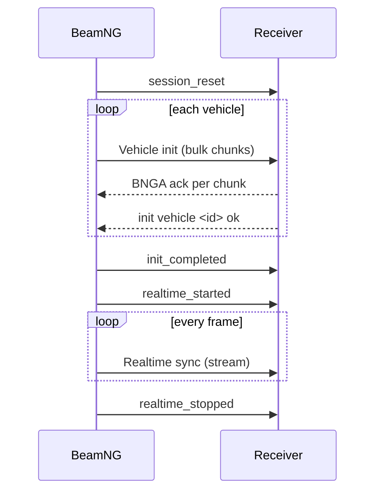

# BNGLink Protocol

Reference for the UDP protocol between BeamNG and a receiver (Blender, Unreal, or anything that implements this document or uses the `bnglink` Python package).

- [Overview](#overview)
- [Conventions](#conventions)
- [Transport](#transport)
- [Control messages](#control-messages)
- [Vehicle init](#vehicle-init)
- [Updates](#updates)
- [Realtime sync](#realtime-sync)
- [Python reference receiver](#python-reference-receiver)

## Overview

The protocol is platform-neutral. All data is sent in BeamNG space with BeamNG names.

Axis, unit and material conversions are the receiver's job.

| Endpoint | Default address | Listens for |
| --- | --- | --- |
| BeamNG | UDP port `6000`, all interfaces | Chunk acks, init replies, `pong` |
| Receiver | UDP `127.0.0.1:6001` | Everything else |

BeamNG sends every datagram from its listening socket, so the source address of a BeamNG datagram is always the BeamNG endpoint address. The defaults can be changed from the BeamNG UI, the receiver UI or the `BNGLINK_HOST`, `BNGLINK_BEAMNG_PORT` and `BNGLINK_RECEIVER_PORT` environment variables (see the README).

### Messages

BeamNG to receiver:

| Message | Channel | When |
| --- | --- | --- |
| [Control](#control-messages) | Control | Lifecycle notifications and the heartbeat |
| [Vehicle init](#vehicle-init) | Bulk | Once per vehicle, again when its mesh layout or skin changes |
| [Paint update](#paint-update) | Bulk | A ready vehicle's paint changed |
| [Texture update](#texture-update) | Bulk | A dynamic decal, license plate or dashboard screen texture changed |
| [Material update](#material-update) | Update | Light, glow or damage material switches changed |
| [Realtime sync](#realtime-sync) | Stream | Every frame while realtime is active |

Receiver to BeamNG:

| Message | Payload | Meaning |
| --- | --- | --- |
| Chunk ack | `BNGA` + `u32` transfer id + `u32` chunk | One bulk chunk was received |
| Init ok | `init vehicle <id> ok` | The vehicle is built. BeamNG sends the next init. |
| Init missing | `init vehicle <id> missing` | The init references a cached asset the receiver does not have |
| Init failed | `init vehicle <id> failed` | The receiver could not build the vehicle and skipped it |
| Pong | `pong` | Answer to a `ping` control message |

Replies other than the chunk ack are plain UTF-8 datagrams without a header.

### Session sequence



1. A full init sends `session_reset`, then one init per enabled vehicle. Only one init is in flight at a time: the next one is sent after the receiver's reply.
2. After the last reply, BeamNG sends `init_completed`.
3. With realtime enabled, BeamNG sends `realtime_started`, then a sync frame every frame with every ready vehicle.
4. Paint, texture and material updates are sent for ready vehicles whenever they change.
5. When a vehicle's parts, mesh layout or skin change, BeamNG sends `realtime_stopped` (if realtime was active), `vehicle_change_detected`, `init_start` and a new init for that vehicle, then `init_completed` and `realtime_started` again once the init is confirmed.
6. A removed vehicle sends `vehicle_removed <id>`.
7. While an init or realtime is active, BeamNG sends `ping` once per second. BeamNG considers the receiver connected while any reply arrived within the last 3 seconds.

## Conventions

### Encoding

- All numbers are little endian: `u8`, `u32`, `i32`, `f32`, `f64`.
- Arrays are tightly packed, without padding.
- JSON is produced by BeamNG's `jsonEncode`.

### Spaces and units

- Distances are in meters. BeamNG space is Z up.
- **Node positions and prop transforms are relative to the vehicle position**, in world axes. The vehicle position itself is sent in world space in every sync frame. Add it to get world positions.
- **Skin axes** are `(x, z, -y)` of BeamNG space, the axis order the BeamNG GPU mesh uses for vertex positions. Rest positions in the init are in skin axes, normals and tangents are in BeamNG space.

### Matrix12

A 3x4 affine transform stored as 12 `f32` (or 12 JSON numbers), row by row. The first three columns are the basis vectors and the last column is the translation:

```
| m0  m1  m2  m3  |
| m4  m5  m6  m7  |
| m8  m9  m10 m11 |
| 0   0   0   1   |
```

The matrix acts on column vectors: `p' = M * p`.

### Triangle data

Meshes are triangle lists. With `I` the index count:

- UVs are stored per triangle corner: `I` UV pairs.
- Material ids and switch ids are stored per triangle: `I / 3` values.

## Transport

### Datagram header

Every datagram from BeamNG starts with a 17 byte header:

| Offset | Type | Field | Meaning |
| --- | --- | --- | --- |
| 0 | 4 bytes | `magic` | `BNG1` |
| 4 | `u8` | `kind` | Channel: `0` stream, `1` bulk, `2` control, `3` update |
| 5 | `u32` | `transferId` | Transfer id, see below |
| 9 | `u32` | `chunk` | Zero-based chunk index |
| 13 | `u32` | `count` | Number of chunks in the transfer |
| 17 | bytes | `payload` | Chunk data, at most 42000 bytes |

A message is sent as one **transfer**, split into `count` chunks of up to 42000 bytes. The receiver concatenates chunks `0..count-1` in order to get the transfer payload.

Transfer ids come from one counter shared by all channels. It starts at 1 when the sender loads and increments with every transfer. A receiver that gets transfer id 1 after higher ids treats it as a sender restart and drops everything it knew about older transfers.

### Receiver rules

- Ignore datagrams with a wrong magic, an unknown kind, `count == 0`, `chunk >= count` or a payload larger than 42000 bytes.
- Ignore transfers larger than 256 MB in total.
- Ignore a transfer older than the last completed transfer of the same channel. Starting a newer transfer on a channel drops the incomplete older one.
- Drop incomplete transfers after 5 seconds without a new chunk.

### Channels

**Bulk** is reliable. BeamNG sends one bulk transfer at a time, keeps up to 128 unacked chunks in flight, sends at most 2 MB per frame and resends a chunk that was not acked within 0.1 s. The receiver acks every bulk chunk it gets, including duplicates, to the source address of the datagram:

| Offset | Type | Field |
| --- | --- | --- |
| 0 | 4 bytes | `BNGA` |
| 4 | `u32` | `transferId` |
| 8 | `u32` | `chunk` |

Acks that do not match a chunk in flight are ignored. The transfer is done once every chunk is acked.

**Stream, control and update** are unreliable. All chunks are sent at once and never acked or resent. A lost chunk loses the whole transfer.

- Streams are latest-wins: a receiver behind on frames only needs to decode the newest complete one.
- Material updates only carry what changed, so a lost update leaves the receiver out of date until the same switch changes again.

### Framed payloads

Bulk and update payloads start with JSON metadata:

| Type | Field |
| --- | --- |
| `u32` | JSON length in bytes |
| bytes | JSON metadata object |
| bytes | Binary body (may be empty) |

The metadata `type` field selects the message: `paint_update`, `texture_update`, `material_update`, or no `type` for a vehicle init. Stream and control payloads are not framed.

Receivers should reject JSON metadata larger than 16 MiB, invalid counts, indices or binary ranges, and payloads with missing or trailing data.

## Control messages

Control payloads are plain UTF-8 strings:

| Message                   | Meaning                                                        |
| ------------------------- | -------------------------------------------------------------- |
| `session_reset`           | A full init starts. Clear all vehicles and every cached asset. |
| `init_start`              | A vehicle reinit is queued outside a full init.                |
| `init_completed`          | All queued inits are done.                                     |
| `vehicle_change_detected` | A vehicle is being rebuilt. A new init for it follows.         |
| `vehicle_removed <id>`    | Remove this vehicle. Shared cached assets are kept.            |
| `realtime_started`        | Sync frames start.                                             |
| `realtime_stopped`        | Sync frames stop. Vehicles stay in their last state.           |
| `ping`                    | Heartbeat. Reply `pong` to the BeamNG endpoint.                |

## Vehicle init

A vehicle init is a framed bulk payload without a `type` field. It contains everything needed to build one vehicle.

### Metadata

| Field | Type | Meaning |
| --- | --- | --- |
| `vehicleId` | number | BeamNG object id |
| `geometry` | object | `key` (string), `included` (bool), and when included `parts` and `props` |
| `nodeIds` | array | BeamNG node ids, in sync order. Only sent when the geometry is included. |
| `props` | array | Prop instances: `pid`, `bindMatrix`, `liveInitMatrix` (Matrix12) |
| `materials` | array | [Material](#materials) definitions, indexed by the mesh material ids |
| `textures` | array | [Texture](#textures) descriptors, indexed by the material texture fields |
| `paints` | array | The three vehicle [paint](#paints) slots |

- `geometry.parts[]`: `{name, uniqueVertCount, indexCount}`, one per skinned body mesh (flexmesh), sorted by name.
- `geometry.props[]`: `{name, vertCount, indexCount}`, one per rigid prop mesh, in the same order as the top-level `props[]`.
- `props[].pid` is the BeamNG prop id. `bindMatrix` is the prop mesh's render transform at init, `liveInitMatrix` its live transform at init, in the same space as the sync matrices.

### Asset caching

Geometry and textures are identified by keys:

| Asset           | Key                                       |
| --------------- | ----------------------------------------- |
| Geometry        | `geometry.key`, a hash of the mesh layout |
| Static texture  | Its source path                           |
| Dynamic texture | `<vehicleId>:<path>`                      |

BeamNG remembers the keys of every confirmed init. When a key was already delivered in the session, the init only carries the key:

- Geometry: `geometry.included` is `false`, and `nodeIds`, `geometry.parts`, `geometry.props` and the geometry blocks are left out.
- Texture: the descriptor has no `offset` and `size`.

The receiver resolves these from its cache. Dynamic textures always carry their data.

A receiver that does not know a referenced key replies `init vehicle <id> missing`. BeamNG then forgets every delivered key and resends that vehicle in full. `session_reset` clears the cache on both sides.

### Binary body

1. When the geometry is included: one part block per `geometry.parts[]` entry, then one prop block per `geometry.props[]` entry.
2. The texture blob: the data of every texture descriptor with an `offset`, in descriptor order. Offsets are relative to the start of the blob.

**Part block** (`V = uniqueVertCount`, `I = indexCount`):

| Type | Count | Content |
| --- | --- | --- |
| `f32` | `V * 3` | Rest positions, skin axes |
| `f32` | `V * 3` | Normals, BeamNG space |
| `f32` | `V * 4` | Tangents, BeamNG space, `w` = handedness |
| `u32` | `I` | Triangle corner vertex indices |
| record | `V` | Skin locators, 28 bytes each (below) |
| `f32` | `I * 2` | UV1 per corner |
| `f32` | `I * 2` | UV2 per corner |
| `u32` | `I / 3` | Material id per triangle |
| `u32` | `I / 3` | Material switch id + 1 per triangle, `0` when static |

**Skin locator** (28 bytes):

| Type | Count | Content |
| --- | --- | --- |
| `i32` | 4 | Node ids: reference `R`, X axis, Y axis, Z axis. Negative when missing. |
| `f32` | 3 | Vertex coordinates `(cx, cy, cz)` in the locator frame |

**Prop block** (`V = vertCount`): the same layout without the skin locators. Props are rigid and follow their sync matrices.

### Skinning

Body vertices follow the node positions of each sync frame. For a vertex with locator nodes `R`, `X`, `Y`, `Z` and coordinates `c`:

```
A = pos(X) - pos(R)
B = pos(Y) - pos(R)
C = pos(Z) - pos(R)              or normalize(cross(A, B)) when Z is missing

f = clamp(c, 0, 1) + (c - clamp(c, 0, 1)) / (|A|, |B|, |C|)

vertex = pos(R) + A * f.x + B * f.y + C * f.z
```

The part of a coordinate inside `[0, 1]` scales with its axis, the part outside is a fixed distance along the axis direction. A missing X or Y axis node falls back to the reference node. The result is in BeamNG space, relative to the vehicle position.

### Materials

Every material has `id`, `name`, `sourceName`, `pbr15`, `layers`, `blendOp`, `transparent`, `zWrite`, `alphaTest`, `alphaRef`, `opacityFactor` and `doubleSided`. `id` equals the material's index in `materials[]`.

Conventions for the fields below:

- `*Texture` fields are indices into `textures[]`, each with a matching `*UseUV1` flag.
- Optional fields are left out when the source material does not set them.
- Colors are linear RGBA.
- Mask textures (metallic, roughness, AO, opacity, clear coat and detail masks) use their red channel.

**Layers.** `layers[]` mirrors the active BeamNG material stages. Each layer is blended over the ones below it by its opacity. A layer may contain:

| Group | Fields |
| --- | --- |
| Base color | `baseColorTexture`, `baseColorFactor` |
| Surface | `metallicTexture` / `metallicFactor`, `roughnessTexture` / `roughnessFactor`, `aoTexture`, `opacityTexture` / `opacityFactor` |
| Normal | `normalTexture`, `normalStrength` |
| Emissive | `emissiveTexture`, `emissiveFactor`, `emissiveIntensity`, `legacyEmissive` |
| Clear coat | `clearCoatTexture` / `clearCoatFactor`, `clearCoatRoughnessTexture` / `clearCoatRoughnessFactor` |
| Detail | `detailBaseColorTexture`, `detailMetallicTexture`, `detailRoughnessTexture`, `detailAoTexture`, `detailOpacityTexture`, `detailNormalTexture`, their `detail*Strength`, `detailScale` |
| Other | `overlayTexture`, `specularTexture` / `specularFactor`, `reflectivityTexture` / `reflectivityFactor`, `anisotropy` |

**Paint.** Painted materials have a `paint` object. Their base color comes from the vehicle paint slots:

- `mode = "palette"`: `paletteTexture`, `colorMapTexture`, `opacityTexture`, `clearCoatTexture`, `paletteOnTop`, the `palette*` flags selecting which channels the palette drives, `paintMetallicFactor`, `paintRoughnessFactor`, `clearCoatFactor`, `clearCoatRoughnessFactor`, `baseColorFactor`, `opacityFactor` and UV flags.
- `mode = "instance"`: `colorMapTexture` and `diffuseUseUV1`.

**Top-level summary.** The material also repeats the main surface maps at the top level (`baseColorTexture`, `normalTexture`, `metallicTexture`, `roughnessTexture`, `emissiveTexture`, `opacityTexture` and their factors). Unpainted PBR 1.5 materials with a skin stage also get a `skinOverlay` with `colorTexture`, `opacityTexture` and UV flags. The bundled receivers build materials from `layers` and `paint`, and only read the top-level base color.

**Switch variants.** Materials referenced by material switches (`off`, `on` and `on_intense` light variants, damaged variants) are appended after the mesh materials.

### Textures

| Field | Meaning |
| --- | --- |
| `key` | Cache key, see [Asset caching](#asset-caching) |
| `name` | File name |
| `mime` | `image/png` or `image/jpeg` |
| `dynamicKind` | `decal`, `plate`, `cef` (dashboard screen) or absent for static textures |
| `offset`, `size` | Position of the data in the texture blob, when included |

DDS files are converted to PNG. License plates are rendered and dashboard screens are captured to PNG. A dashboard screen that is not active yet at init gets a 1x1 placeholder, replaced later by a texture update.

### Paints

Each of the three paint slots has `baseColor` (linear RGBA), `metallic`, `roughness`, `clearcoat` and `clearcoatRoughness`.

## Updates

Updates are framed payloads for a vehicle that is already initialized. A receiver should ignore updates for unknown vehicles.

### Paint update

Bulk, empty body.

```
{"type": "paint_update", "vehicleId": 32575, "paints": [<slot 0>, <slot 1>, <slot 2>]}
```

`paints` has the same layout as in the init and replaces it. A slot looks like `{"baseColor": [0.8, 0.1, 0.1, 1.0], "metallic": 0.5, "roughness": 0.3, "clearcoat": 1.0, "clearcoatRoughness": 0.05}`.

### Texture update

Bulk. The body is the concatenated texture data.

```json
{"type": "texture_update", "vehicleId": 32575, "textures": [{"index": 57, "offset": 0, "size": 18234, "mime": "image/png", "name": "..."}]}
```

`index` is the texture's index in the init `textures[]`. `offset` and `size` locate its data in the body.

### Material update

Update channel, empty body.

```json
{"type": "material_update", "vehicleId": 32575, "switches": [{"id": 12, "materialId": 41, "emissiveScale": 1.0}]}
```

Each switch changes the material of the triangles tagged with that switch id:

| Field | Meaning |
| --- | --- |
| `id` | Material switch id, as in the mesh switch ids (without the `+ 1`) |
| `materialId` | Index into `materials[]`. Omitted to restore the triangles' base material. |
| `emissiveScale` | Light intensity, from `0` (off) to `1` (fully on). Headlights are further scaled by `0.25` on low beam and `2` on high beam. |
| `damaged` | `true` for a damage override, `false` to remove one. Absent for normal switch changes. |

Only switches that changed since the last update are sent. Damage overrides take priority over normal switch states and are also repeated in every [sync frame](#realtime-sync).

## Realtime sync

A sync frame is a stream payload, not framed. It contains every ready vehicle.

Header (16 bytes):

| Type | Content |
| --- | --- |
| `u32` | Sequence number |
| `u32` | Vehicle count |
| `f64` | BeamNG simulation time, seconds |

Then for each vehicle:

| Type | Count | Content |
| --- | --- | --- |
| `u32` | 1 | Vehicle id |
| `u32` | 1 | Node count `N` |
| `f32` | `N * 3` | Node positions relative to the vehicle position, in init `nodeIds` order |
| `f32` | 3 | Vehicle world position |
| `u32` | 1 | Prop count `P` |
| `f32` | `P * 12` | Live prop Matrix12, relative to the vehicle position, in init `props` order |
| `u32` | 1 | Damage revision |
| `u32` | 1 | Broken beam count `B` |
| `u32` | `B * 2` | Broken beam endpoints, as indices into `nodeIds` |
| `u32` | 1 | Hidden prop count `H` |
| `u32` | `H` | Hidden prop ids (`pid`) |
| `u32` | 1 | Damaged material switch count `S` |
| `u32` | `S * 2` | Switch id and damaged material id pairs |

**Props.** Place a prop with `bindMatrix * inverse(liveInitMatrix) * liveMatrix`, using 4x4 versions of the Matrix12 values.

**Damage.** The damage state is collected inside each vehicle by the BNGLink vehicle extension (`beamng/vlua/BNGLink.lua`, loaded by the sender at init), which reports broken beams with mesh breaking enabled, deform-group material switches and hidden props. Without that extension, the damage blocks stay empty. The state is cumulative: every frame carries the full state, not the changes. The revision increases whenever the state changes, so receivers can skip unchanged damage. A body triangle is hidden when both endpoints of a broken beam are among the locator nodes of its vertices, matching BeamNG's flexmesh break behavior.

**Simulation time.** `simTime` accumulates the game's simulation time step, so it stops while the simulation is paused and slows down in slow motion. Receivers can use it to time recordings on the game's clock instead of their receive time.

## Python reference receiver

The `bnglink` package implements the receiver side:

- `UdpComm`: socket, chunk reassembly and acks.
- `BngDecoder`: decodes payloads to Python objects and keeps the asset cache.
- `LinkSession`: ties both together, answers `ping`, replies `missing` on unknown keys and `failed` when the init handler raises, and dispatches decoded messages to handlers.

```python
import bnglink

def on_init(session, init):
    build_vehicle(init)
    session.confirm_ready(init['vehicle_id'])

def on_sync(session, vehicles):
    for vehicle in vehicles:
        deform_and_place(vehicle)

session = bnglink.LinkSession(
    '127.0.0.1', 6001,          # receiver address to bind
    ('127.0.0.1', 6000),        # BeamNG address
    {'init': on_init, 'sync': on_sync},
    print,                      # log function
)
while True:
    session.poll()  # decodes at most one sync per call, the newest
```

`LinkSession` only accepts datagrams whose source address equals the BeamNG address it was given.

### Handlers

Handlers are called as `handler(session, data)` and keyed by message name: `session_reset`, `vehicle_removed`, `init`, `paint_update`, `texture_update`, `material_update`, `sync`. Other control messages are logged. An exception in a handler is logged and does not stop the session. For `init`, it removes the vehicle and replies `failed`.

### Decoded objects

`init`: `vehicle_id`, `geometry_key`, `node_ids`, `parts`, `props`, `materials`, `textures`, `paints`.

- Part: `name`, `verts`, `normals`, `tangents` (all three in skin axes), `faces`, `uvs`, `uvs2`, `material_ids`, `switch_ids` (`-1` when static), and the skin arrays `ref_idx`, `px_idx`, `py_idx`, `pz_idx`, `pz_valid`, `coords_clipped`, `coords_residual`, with node ids mapped to sync node indices.
- Prop: the same mesh fields, plus `pid`, `bind_matrix` and `live_init_matrix`.
- Texture: `key`, `name`, `mime`, `data`.
- Material: the metadata object, plus a `cache_key` so identical materials can be shared across vehicles.

`sync`: a list of `{vehicle_id, sim_time, node_raw [N, 3], origin, prop_mats [P, 12], damage_revision, broken_beams [B, 2], hidden_props [H], damaged_switches [S, 2]}`.

`paint_update`, `material_update`, `texture_update`: `vehicle_id` plus `paints`, `switches` or `textures`.

### Decoder notes

- Mesh names lose their `.001` style suffix.
- Degenerate triangles are dropped together with their corner data.
- `merge_part_skins()` and `BngDecoder.deform_body()` deform a whole body from `node_raw` in one call, applying the [skinning](#skinning) formula. The output is in skin axes.
